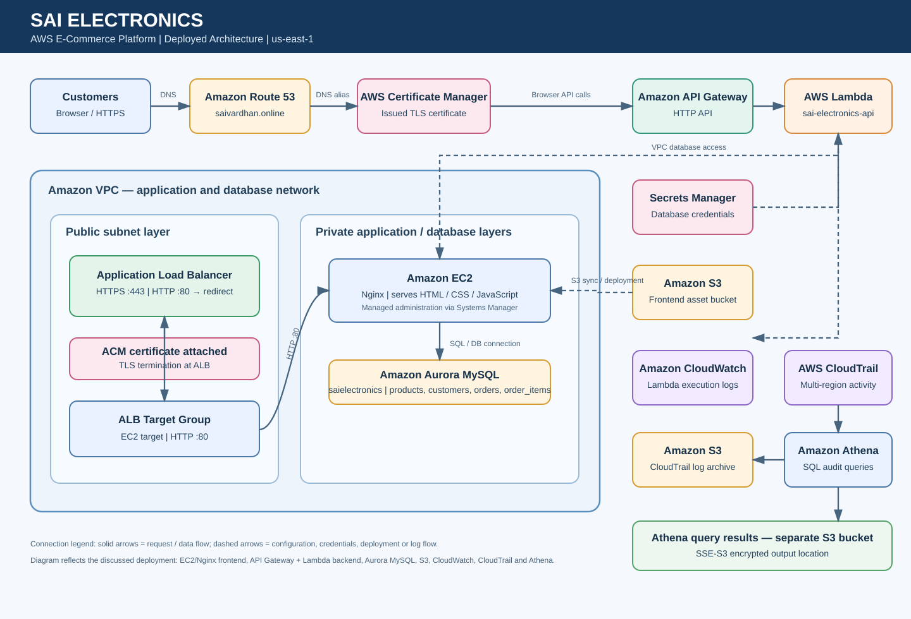

# SAI ELECTRONICS

**AWS E-Commerce Platform with Serverless APIs and Cost-Aware Audit Analytics**

A full-stack electronics e-commerce demonstration deployed on AWS. The web frontend is served by Nginx on Amazon EC2 behind an Application Load Balancer, while application APIs run on Amazon API Gateway and AWS Lambda with an Amazon Aurora MySQL database.

- **Live website:** https://saivardhan.online
- **AWS Region:** `us-east-1`

## AWS architecture

[Open the scalable SVG architecture diagram](docs/architecture/SAI_ELECTRONICS_AWS_Architecture.svg)

### Main request and data flows

1. Customers resolve `saivardhan.online` through Amazon Route 53.
2. The internet-facing Application Load Balancer receives HTTPS on port 443 using an AWS Certificate Manager (ACM) certificate. HTTP port 80 redirects to HTTPS.
3. The ALB target group forwards website requests to the private EC2 application instance.
4. Nginx on EC2 serves the HTML, CSS and JavaScript storefront. Frontend assets are stored in Amazon S3 and synchronized to the EC2 web root.
5. Browser JavaScript calls the Amazon API Gateway HTTP API.
6. API Gateway invokes the `sai-electronics-api` AWS Lambda function.
7. Lambda retrieves the database secret from AWS Secrets Manager and connects to Amazon Aurora MySQL over VPC networking.
8. Lambda execution records are written to Amazon CloudWatch Logs.
9. AWS CloudTrail records account activity and delivers audit files to S3. Amazon Athena queries those logs using SQL; query outputs are stored in a separate S3 bucket.

## AWS services and tools

| Service | Role |
|---|---|
| Amazon Route 53 | Public DNS for the application domain |
| AWS Certificate Manager (ACM) | TLS certificate for the ALB HTTPS listener |
| Amazon VPC | Network isolation and public/private subnet layout |
| Application Load Balancer (ALB) | HTTPS entry point and routing to the web target group |
| EC2 | Hosts the Nginx frontend server in a private application subnet |
| Nginx | Serves the website files |
| Amazon S3 | Frontend asset storage, CloudTrail log archive and separate Athena query-result storage |
| Amazon API Gateway | Exposes the application HTTP API |
| AWS Lambda | Serverless backend API logic |
| Amazon Aurora MySQL | Customer, product, order and order-item database |
| AWS Secrets Manager | Database credential storage |
| AWS Systems Manager Session Manager | Managed EC2 administration access |
| Amazon CloudWatch Logs | Lambda execution logging |
| AWS CloudTrail | Multi-Region AWS account activity auditing |
| Amazon Athena | SQL analysis of CloudTrail audit data |

## Application features

- Customer registration and login
- Electronics catalogue with 50 product records
- Product photographs, categories, prices and stock display
- Shopping cart and order creation
- Stock validation and updates during order creation
- Customer order history
- UPI QR payment instructions and transaction-reference submission
- Admin pending-payment review workflow

## Customer order and payment flow

1. The customer browses products, signs in and adds products to the cart.
2. The frontend submits selected product IDs and quantities to the order API.
3. Lambda validates customer and stock information, calculates the total using database prices, creates the order and order items, and updates product stock.
4. The application displays UPI payment instructions and accepts a transaction reference.
5. An administrator reviews the submitted reference through the admin workflow.

**Payment note:** A submitted UPI reference is a request for manual review, not automatic proof of funds received. Payment must be reconciled against the merchant bank/UPI record before an order is treated as paid.

## Monitoring and audit analytics

- Lambda execution logs are available in CloudWatch Logs.
- CloudTrail records AWS account management activity and stores audit files in S3.
- An Athena table is configured for the CloudTrail dataset.
- Athena SQL queries can inspect event time, event source, event name, Region, source IP and error code.
- Athena query results are stored in a separate S3 bucket using SSE-S3 encryption.

## Security and operational considerations

- The website is served over HTTPS through the ALB listener and ACM certificate.
- Database credentials are retrieved by Lambda from Secrets Manager.
- EC2 administration uses Systems Manager Session Manager.
- Customer identity and order ownership should be enforced server-side before production use; a browser-held customer ID is not a substitute for token/session authentication and authorization.
- UPI references should be verified against merchant transaction records before payment approval.
- Restrict CORS and administrative access to the minimum required origins and permissions.
- Review service usage, CloudWatch log retention and S3 lifecycle policies to manage costs.

## Documentation

- [Final project documentation (Markdown)](docs/FINAL_PROJECT_DOCUMENTATION.md)
- [AWS architecture diagram (SVG)](docs/architecture/SAI_ELECTRONICS_AWS_Architecture.svg)

---
**Project:** SAI ELECTRONICS  
**Architecture pattern:** EC2-hosted web frontend + serverless API backend + managed relational database.
